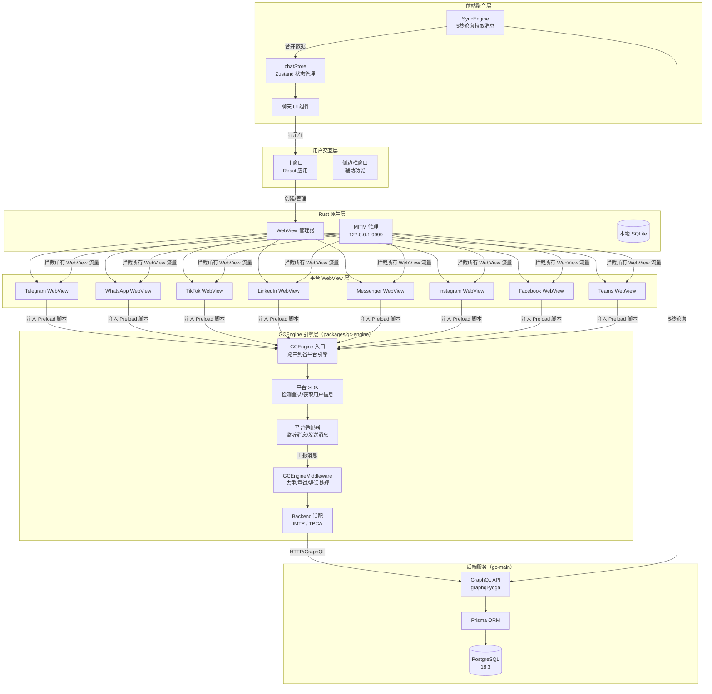

# Global Chats 系统交接文档

> **交接对象**：全栈开发同事（初中级，依赖 AI 辅助编程）
> **交付时间**：本周内
> **核心原则**：在现有代码基础上修复 Bug、补全功能、优化体验，**不是重写**
> **配套文件**：
> - `PROJECT_GUIDE.md` — 项目完整分析文档（架构、目录、启动流程）
> - `LOCAL_RUN_GUIDE.md` — 本地运行手册（环境搭建、数据库、启动步骤）
> - `gc-app-mono/prototype.html` — 前端原型 Demo（浏览器直接打开即可预览）

---

## 目录

1. [项目业务背景](#1-项目业务背景)
2. [技术栈速览](#2-技术栈速览)
3. [系统架构总览](#3-系统架构总览)
4. [代码地图（快速定位文件）](#4-代码地图快速定位文件)
5. [平台监听机制详解（重点）](#5-平台监听机制详解重点)
6. [已知 Bug 和不完整功能清单（按优先级排序）](#6-已知-bug-和不完整功能清单按优先级排序)
7. [修复建议和路线图](#7-修复建议和路线图)
8. [本地运行指南（速查）](#8-本地运行指南速查)
9. [开发注意事项和踩坑提醒](#9-开发注意事项和踩坑提醒)
10. [给接手同事的实用建议](#10-给接手同事的实用建议)

---

## 1. 项目业务背景

### 1.1 这个系统是做什么的

**Global Chats（全球聊天）** 是一款面向**外贸行业**的桌面端聚合聊天工具。

核心价值：**把散落在多个外贸平台上的客户消息，汇聚到一个统一界面中处理**。

想象一个外贸业务员的日常：他需要同时打开 Telegram、WhatsApp、TikTok、LinkedIn、Messenger、Instagram、Facebook、Teams 这 8 个平台的网页版，逐个检查有没有新消息、逐个回复。这个系统就是为了**消灭这种低效操作**而生的。

### 1.2 老板想要什么

> ⚠️ **老板没有写需求文档**，以下是根据现有代码和沟通推断出的需求：

| 需求 | 说明 | 当前状态 |
|------|------|----------|
| 多平台聚合聊天 | 一个界面看到所有平台的消息 | ✅ UI 框架已完成 |
| 实时消息监听 | 各平台有新消息时立即收到通知 | ⚠️ Telegram 和 WhatsApp 已实现，其他平台用 DOM 监听（不稳定） |
| 统一回复 | 在系统里直接回复各平台的消息 | ❌ 发送消息是假实现（mock），没有真正对接后端 |
| CRM 客户管理 | 右侧面板管理客户信息 | ⚠️ UI 有了，数据是空的 |
| 实时翻译 | 消息自动翻译 | ⚠️ 翻译调度器有代码，但翻译服务对接不完整 |
| 文件/图片发送 | 发送图片和文件 | ❌ 上传功能被禁用了（代码注释掉了） |
| 账号登录管理 | 管理各平台登录状态 | ⚠️ WebView 加载了各平台网页，但登录态管理不完善 |

### 1.3 项目组成

项目分两个独立仓库：

```
gc/
├── gc-app-mono/     # 桌面客户端（Tauri 2 + React 19）— 你主要在这里工作
│   ├── apps/global-chat-desktop/    # 主应用
│   ├── packages/gc-engine/          # 平台适配引擎（核心！）
│   ├── packages/api/                # API 客户端
│   ├── packages/store/              # 状态管理
│   └── ...其他包
│
└── gc-main/         # 后端服务（Next.js 16 + Prisma + PostgreSQL）
    └── packages/gc-app/
        ├── prisma/                  # 数据库 Schema
        ├── docker/                  # Docker 配置
        └── src/                     # 后端源码
```

---

## 2. 技术栈速览

### 2.1 前端（gc-app-mono）

| 技术 | 版本 | 用途 |
|------|------|------|
| Tauri 2 | - | 桌面应用框架，Rust 后端 + WebView 前端 |
| React 19 | - | UI 框架 |
| TypeScript | - | 类型系统 |
| Zustand | - | 状态管理（5 个 Store：global/app/chat/sync/ui） |
| TailwindCSS 4 | - | 样式系统 |
| Turborepo + Bun | - | Monorepo 管理 |
| Vite | - | 构建工具（含 preload 脚本单独构建） |

### 2.2 后端（gc-main）

| 技术 | 版本 | 用途 |
|------|------|------|
| Next.js 16 | - | 后端框架 |
| Prisma | - | ORM |
| PostgreSQL | 18.3 | 数据库 |
| graphql-yoga | - | GraphQL API |
| JWT | - | 身份认证 |

### 2.3 Rust 端（Tauri src-tauri）

| 技术 | 用途 |
|------|------|
| tauri 2 | 桌面应用核心 |
| cao_proxy | MITM 代理服务器（127.0.0.1:9999） |
| rusqlite | 本地 SQLite 存储 |
| log | 日志系统 |

---

## 3. 系统架构总览

### 3.1 整体架构图



### 3.2 数据流：一条新消息从平台到界面的完整路径

```
1. 用户在 Telegram WebView 中收到新消息
2. Preload 脚本已注入 → GCEngine 启动
3. TelegramAdapter 通过 Webpack 模块劫持拦截到新消息事件
4. 调用 GCEngineMiddleware.reportMessages() 上报
5. Middleware 去重（DedupeStore）→ 重试（withRetry）→ IMTP Backend
6. IMTP Backend 发送 GraphQL 请求到后端
7. 后端写入 PostgreSQL (ImWhatsappMessage 表)
8. 前端 SyncEngine 5秒轮询拉取新消息
9. chatStore.mergeImtpMessages() 合并到本地状态
10. React 组件重新渲染，用户看到消息
```

### 3.3 三层架构理解

```
┌─────────────────────────────────────────────┐
│  GCEngine（入口）                           │
│  ├── 根据 EPlatform 枚举路由到对应引擎     │
│  └── 调用 initThirdApp() + excApp()         │
├─────────────────────────────────────────────┤
│  平台 SDK（检测层）                         │
│  ├── 检测是否已登录（isLoginEd）            │
│  ├── 轮询登录状态变化                       │
│  ├── 获取当前用户信息                       │
│  └── 检测当前聊天对象变化                   │
├─────────────────────────────────────────────┤
│  平台适配器（操作层）                       │
│  ├── 监听新消息（每种平台策略不同！）       │
│  ├── 发送消息                               │
│  └── 获取历史消息                           │
├─────────────────────────────────────────────┤
│  Middleware（中间层）                       │
│  ├── 消息去重                               │
│  ├── 失败重试（指数退避）                   │
│  ├── 错误标准化                             │
│  └── 实时事件广播                           │
├─────────────────────────────────────────────┤
│  Backend（后端适配层）                      │
│  ├── IMTP 协议（REST API → GraphQL）        │
│  └── TPCA 协议（GraphQL，规划中）           │
└─────────────────────────────────────────────┘
```

---

## 4. 代码地图（快速定位文件）

> 当你接到一个任务时，先在这里找到对应的文件位置。

### 4.1 前端主应用

| 你要找什么 | 文件路径 |
|------------|----------|
| 应用入口 | `apps/global-chat-desktop/src/main.tsx` |
| 路由配置 | `apps/global-chat-desktop/src/router.tsx` |
| 登录页 | `apps/global-chat-desktop/src/pages/sign-in/` |
| 聊天主界面 | `apps/global-chat-desktop/src/modules/aggregated-chat/` |
| 左侧平台列表 | `apps/global-chat-desktop/src/pages/left-side-view/` |
| 中间聊天列表 | `apps/global-chat-desktop/src/pages/chat-list-view/` |
| 右侧功能面板 | `apps/global-chat-desktop/src/pages/right-side-view/` |
| 翻译页面 | `apps/global-chat-desktop/src/pages/right-side-view/translate/` |

### 4.2 状态管理（Zustand Store）

| Store | 文件路径 | 管理什么 |
|-------|----------|----------|
| globalStore | `packages/store/src/globalStore.ts` | 全局状态：用户信息、工作空间 |
| appStore | `packages/store/src/appStore.ts` | 应用状态：平台列表、WebView 管理 |
| chatStore | `apps/global-chat-desktop/src/modules/aggregated-chat/store/chatStore.ts` | 聊天数据：账号、会话、消息 |
| syncStore | `apps/global-chat-desktop/src/modules/aggregated-chat/store/syncStore.ts` | 同步状态：轮询控制、游标 |
| uiStore | `apps/global-chat-desktop/src/modules/aggregated-chat/store/uiStore.ts` | UI 状态：选中会话、面板切换 |

### 4.3 GCEngine（平台适配引擎）

| 文件路径 | 说明 |
|----------|------|
| `packages/gc-engine/src/GCEngine.ts` | 引擎入口，路由到各平台 |
| `packages/gc-engine/src/apps/engine/AbstractAppEngine.ts` | 引擎抽象基类 |
| `packages/gc-engine/src/apps/engine/sdk/AbstractAppSDK.ts` | SDK 抽象基类 |
| `packages/gc-engine/src/apps/telegram/sdk/src/index.ts` | **Telegram 适配器**（Webpack 劫持） |
| `packages/gc-engine/src/apps/telegram/sdk/src/runtime-adapter.ts` | Webpack 运行时提取 |
| `packages/gc-engine/src/apps/whatsapp/adapters/wa-web/bindings/MessageBinding.ts` | **WhatsApp 消息监听** |
| `packages/gc-engine/src/apps/whatsapp/adapters/wa-web/ModuleLoader.ts` | WhatsApp 内部模块加载器 |
| `packages/gc-engine/src/apps/tiktok/tiktok.ts` | **TikTok DOM 监听** |
| `packages/gc-engine/src/middleware/GCEngineMiddleware.ts` | 中间件核心 |
| `packages/gc-engine/src/middleware/defaultMiddleware.ts` | 中间件工厂 |
| `packages/gc-engine/src/middleware/backend/imtpBackend.ts` | IMTP 后端实现 |

### 4.4 Rust 原生层

| 文件路径 | 说明 |
|----------|------|
| `src-tauri/src/gc_webview/webview.rs` | WebView 创建和配置 |
| `src-tauri/src/cao/proxy/svc_proxy.rs` | MITM 代理服务器 |
| `src-tauri/src/gc_webview/webview_layout_options.rs` | WebView 布局 |
| `src-tauri/src/logging/mod.rs` | 日志系统 |
| `src-preload/index.ts` | Preload 脚本入口 |

### 4.5 后端

| 文件路径 | 说明 |
|----------|------|
| `gc-main/packages/gc-app/prisma/schema.prisma` | 数据库表结构定义 |
| `gc-main/packages/gc-app/prisma/seed.ts` | 种子数据 |
| `gc-main/packages/gc-app/.env.example` | 环境变量模板 |
| `gc-main/docker/docker-compose.yml` | PostgreSQL Docker 配置 |

### 4.6 关键配置文件

| 文件 | 说明 |
|------|------|
| `apps/global-chat-desktop/vite.config.ts` | Vite 配置（主应用构建） |
| `apps/global-chat-desktop/vite.preload.config.ts` | Preload 脚本构建配置 |
| `apps/global-chat-desktop/src-tauri/tauri.conf.json` | Tauri 应用配置 |
| `apps/global-chat-desktop/.env` | 前端环境变量 |
| `gc-main/packages/gc-app/.env` | 后端环境变量 |

---

## 5. 平台监听机制详解（重点）

> ⚠️ **这是整个系统最复杂、最难理解的部分。** 如果你完全看不懂这里的代码，不要慌——先用 AI 辅助理解，大部分 Bug 修复和功能补全其实不涉及这里。

### 5.1 三种监听策略

系统针对 8 个平台使用了 3 种完全不同的消息监听策略：

| 策略 | 适用平台 | 原理 | 稳定性 |
|------|----------|------|--------|
| **策略一：Webpack 模块劫持** | Telegram | 找到 Telegram 网页版内部的 Webpack 运行时，提取其 `callApi` 函数，注册 `addActionHandler` 拦截消息事件 | ⚠️ Telegram 改版就可能失效 |
| **策略二：内部模块绑定** | WhatsApp | WhatsApp Web 用自己的模块系统（不是标准 Webpack），通过名称搜索找到 `WAWebCollections` 模块，hook `msgCollection.on("add")` | ⚠️ WhatsApp 改版就可能失效 |
| **策略三：DOM MutationObserver** | TikTok、LinkedIn、Messenger、Instagram、Facebook、Teams | 监听页面 DOM 变化，通过比对 HTML 结构变化来检测新消息 | ❌ 非常不稳定，只能做粗略检测 |

### 5.2 Telegram 监听详解

**核心文件**：`packages/gc-engine/src/apps/telegram/sdk/src/index.ts`

**工作原理**：

```
1. Telegram Web 网页版使用 Webpack 打包
2. 全局变量 webpackChunktelegram_web_a (或类似名称) 存储 Webpack 模块
3. TelegramAdapter 向这个数组 push 一个自定义模块
4. 自定义模块被 Webpack 执行时，能拿到 webpackRequire 函数
5. 通过 webpackRequire 找到 store 模块和 callApi 函数
6. 调用 addActionHandler("apiUpdate", handler) 拦截所有 API 更新事件
7. 过滤出 newMessage 事件，提取消息内容
```

**关键代码位置**：

```typescript
// runtime-adapter.ts — 提取 webpackRequire
const chunkName = Object.keys(window).find(k => k.startsWith("webpackChunk"));
const chunk = window[chunkName];
chunk.push([[Symbol()], {}, (require) => {
  // 这里 require 就是 webpackRequire
  webpackRequire = require;
}]);

// index.ts — 注册消息处理器
addActionHandler("apiUpdate", (update) => {
  if (update["@type"] === "updateNewMessage") {
    // 拦截到新消息！
    const message = update.message;
    // → 上报到 Middleware
  }
});
```

### 5.3 WhatsApp 监听详解

**核心文件**：`packages/gc-engine/src/apps/whatsapp/adapters/wa-web/bindings/MessageBinding.ts`

**工作原理**：

```
1. WhatsApp Web 使用自定义模块系统（非标准 Webpack）
2. 所有内部模块挂在 window 上，名称格式为 WAWebXxx
3. ModuleLoader 按名称搜索模块（如 "WAWebCollections"）
4. 找到 msgCollection（消息集合）后，调用 .on("add", handler)
5. handler 中检查 isNewMsg 标志，只处理新消息
6. 提取消息内容 → 上报到 Middleware
```

**关键代码**：

```typescript
// MessageBinding.ts
msgCollection.on("add", (msg) => {
  if (msg.isNewMsg) {
    // 拦截到新消息！
    // → 上报到 Middleware
  }
});

// ModuleLoader.ts — 搜索模块
const modules = Object.entries(window).filter(([k]) => k.startsWith("WAWeb"));
// 按名称匹配目标模块
```

**注意**：WhatsApp 的模块搜索有 2 秒轮询 + 5 分钟超时机制，因为模块可能不会立即可用。

### 5.4 TikTok 和其他平台（DOM 监听）

**核心文件**：`packages/gc-engine/src/apps/tiktok/tiktok.ts`

**工作原理**：

```typescript
// 简化版逻辑
const observer = new MutationObserver(throttle(() => {
  // 检查 DOM 变化，比对消息列表
  const chatContainer = document.querySelector("[data-chat-container]");
  // 解析消息内容
}, 100));

observer.observe(document.body, {
  childList: true,
  subtree: true,
});
```

**问题**：DOM 监听无法精确捕获消息内容，依赖页面 DOM 结构，平台改版就会失效。

### 5.5 Middleware（中间件）详解

**核心文件**：`packages/gc-engine/src/middleware/GCEngineMiddleware.ts`

中间件负责处理适配器上报的消息，流程如下：

```
适配器上报消息
    │
    ▼
┌──────────────┐
│ DedupeStore  │ ← 去重：用 platformMessageId 做唯一性判断
│ 去重检查     │    避免同一条消息被重复上报
└──────┬───────┘
       │ 通过
       ▼
┌──────────────┐
│ normalizeError│ ← 错误标准化：把各种异常归类为统一格式
│ 错误处理     │
└──────┬───────┘
       │
       ▼
┌──────────────┐
│ withRetry    │ ← 重试：指数退避策略
│ 重试机制     │    第1次立即，第2次1秒后，第3次2秒后...
└──────┬───────┘
       │ 成功
       ▼
┌──────────────┐
│ IMTP Backend │ ← 后端适配：调用 GraphQL API 写入后端
│ 上报后端     │
└──────────────┘
       │
       ▼
┌──────────────┐
│ RealtimeEventBus│ ← 实时事件总线：在本地广播事件
│ 本地广播     │    让前端组件可以订阅消息更新
└──────────────┘
```

### 5.6 你需要知道的

1. **大部分 Bug 修复不涉及监听代码** — 监听代码很复杂但相对独立，除非平台改版导致监听失效，否则不需要改
2. **如果你需要修改监听逻辑**，先在浏览器 DevTools 中手动测试，理解平台网页版的 DOM 结构和内部模块
3. **`defaultMiddleware.ts` 有一个重要 TODO**：目前所有平台都走 IMTP Backend（原本只用于 WhatsApp），后续需要按平台区分
4. **Preload 脚本是注入到各平台 WebView 中的**，通过 `src-preload/index.ts` 入口编译，IIFE 格式打包

---

## 6. 已知 Bug 和不完整功能清单（按优先级排序）

> 以下是经过完整代码扫描后发现的**所有**Bug、TODO 和不完整功能。
> 按 **P0（必须修复）→ P1（应该修复）→ P2（建议优化）** 排序。

### P0：必须修复（影响核心功能）

#### P0-1. 发送消息是假实现（Mock）

**文件**：`apps/global-chat-desktop/src/modules/aggregated-chat/store/chatStore.ts` 第 133 行

**问题**：
```typescript
// 第 83-91 行：loadAccounts、loadConversations、loadMessages 都是空函数
loadAccounts: async () => {
  set({ accountsState: "success" });  // 直接标记成功，什么都没做
},
loadConversations: async (_accountId?: string) => {
  set({ conversationsState: "success" });  // 同上
},
loadMessages: async (_conversationId: string) => {},  // 空函数

// 第 97-159 行：sendMessage 是假实现
sendMessage: async (conversationId, content) => {
  // 创建一条"发送中"的消息显示在界面上
  // 然后用 setTimeout(500ms) 假装发送成功
  // 实际上根本没有调用后端 API！
  // TODO: 调用服务端 API 发送消息（等服务端接口就绪后对接）
  logger.warn("sendMessage: 服务端接口未就绪，消息已乐观更新但未实际发送");
  setTimeout(() => {
    // 假装成功...
  }, 500);
}
```

**影响**：用户在界面上输入消息后看起来"发送成功"了，但实际上消息没有发到任何平台。

**修复方向**：
- `loadAccounts` → 调用 `apiGetAccounts()`
- `loadConversations` → 调用 `apiGetConversations()`
- `loadMessages` → 调用 `apiGetChatMessages()`
- `sendMessage` → 调用 `apiSendMessage()`，参考 `realChatService.ts` 中的实现

#### P0-2. realChatService 中 senderId 硬编码

**文件**：`apps/global-chat-desktop/src/modules/aggregated-chat/services/realChatService.ts` 第 84-88 行

**问题**：
```typescript
async sendMessage(params) {
  // TODO: 需要根据 conversationId 获取 senderId 和 receiverId
  const data = await apiSendMessage({
    content: params.content,
    senderId: "current_user", // TODO: 从 store 获取当前用户  ← 硬编码！
    receiverId: params.conversationId,
  });
```

**影响**：即使后端 API 就绪，发送的消息 senderId 也是错误的。

**修复方向**：从 `globalStore` 获取当前登录用户的 ID。

#### P0-3. getMessages 从 conversationId 脆弱地提取 accountId

**文件**：`apps/global-chat-desktop/src/modules/aggregated-chat/services/realChatService.ts` 第 57 行

**问题**：
```typescript
async getMessages(params) {
  // 从 conversationId 提取 accountId（假设格式包含 accountId）
  const accountId = params.conversationId.split("_")[0] || "";
```

**影响**：`conversationId` 的格式是 `${accountId}:${imtpConvId}`（用冒号分隔），但这里用 `split("_")` 分割（下划线），会提取失败。

**修复方向**：用 `split(":")[0]` 或从 store 中查找会话对应的 accountId。

#### P0-4. apiSendMessage API 可用性未确认

**文件**：`packages/api/src/api/apiSendMessage.ts`

**问题**：
```typescript
// TODO: 确认后端 SendMessage API 是否可用
```

**影响**：即使前端代码修复了，后端可能还没有对应的 GraphQL mutation。

**修复方向**：检查 gc-main 后端的 GraphQL Schema，确认是否有 `sendMessage` mutation，如果没有需要补充。

### P1：应该修复（影响体验或稳定性）

#### P1-1. 所有平台都走 IMTP Backend

**文件**：`packages/gc-engine/src/middleware/defaultMiddleware.ts`

**问题**：
```typescript
// TODO: 目前所有平台暂时使用 IMTP Backend，后续按需扩展
```

**影响**：IMTP 协议原本是为 WhatsApp 设计的（基于 REST API），其他平台的数据格式不兼容。Telegram、TikTok 等平台的消息上报可能会因为数据格式不匹配而失败。

**修复方向**：为 Telegram 等平台实现 TPCA Backend（GraphQL 协议），或在 IMTP Backend 中做数据格式适配。

#### P1-2. MITM 代理上游地址硬编码

**文件**：`src-tauri/src/cao/proxy/svc_proxy.rs` 第 98 行

**问题**：
```rust
*req.uri_mut() = "http://127.0.0.1:7897".parse().unwrap();
```

**影响**：MITM 代理把所有请求转发到 `127.0.0.1:7897`（可能是 Clash/梯子端口），如果用户没有运行代理软件，所有 WebView 网络请求都会失败。

**修复方向**：从配置文件读取上游代理地址，或检测代理可用性后自动降级为直连。

#### P1-3. 文件上传功能被禁用

**文件**：`packages/gc-engine/src/apps/engine/AbstractAppEngine.ts` 和 `AbstractAppSDK.ts`

**问题**：`updateCurrentUserAvatar` 方法直接 return，没有实现。

**影响**：用户无法更换头像、上传文件。

#### P1-4. 登录失效处理不完整

**文件**：`packages/api/src/apiClient.ts` 第 242 行

**问题**：
```typescript
// TODO: 登录失效
return response;
```

**影响**：当 Token 过期或无效时，不会自动跳转到登录页，用户会看到不明确的错误。

**修复方向**：在响应拦截器中检测 401 状态码或 `authBadUin` 错误码，调用 `onAuthError()` 跳转登录。

#### P1-5. Scheduler 中有两处空 TODO

**文件**：`packages/gc-engine/src/scheduler/index.ts`

**问题**：
- 第 25 行：`// TODO: flush` — 在消息文本超长时需要先 flush 已有内容，当前直接执行了 flush（可能没问题但需确认）
- 第 135 行：`// TODO:` — `safeUpdateCookedText` 方法体为空

**影响**：翻译调度器在某些边界情况下可能丢失翻译结果。

### P2：建议优化（代码质量和健壮性）

#### P2-1. 大量 `as any` 类型断言

**文件**：`packages/api/src/apiClient.ts`、`packages/adapter/src/axios-tauri-api-adapter/axios-tauri-api-adapter.ts`

**问题**：`apiClient.ts` 中有 10+ 处 `as any` 类型断言，`axios-tauri-api-adapter` 中有 5+ 处 `@ts-ignore`。

**影响**：TypeScript 类型安全被绕过，潜在的类型错误不会被编译器捕获。

**修复方向**：逐步为 `config` 对象定义正确的类型扩展（声明 `gcMeta`、`startTime` 等自定义字段）。

#### P2-2. Windows 退出逻辑未实现

**文件**：`apps/global-chat-desktop/src/utils/checkForAppUpdates.ts`

**问题**：
```typescript
// TODO: windows exit
```

**影响**：Windows 平台上应用更新后可能无法正确退出。

#### P2-3. Product 模型未定义

**文件**：`packages/model/src/data/operation/product.ts`

**问题**：
```typescript
// TODO: product info
```

**影响**：CRM 中的商品管理功能缺少数据模型，右侧面板的商品功能无法实现。

#### P2-4. helper.ts 中未决定的逻辑分支

**文件**：`packages/gc-engine/src/utils/helper.ts`

**问题**：
```typescript
// TODO: 这里用break 还是 continue
```

**影响**：循环逻辑不确定，可能导致消息处理行为不符合预期。

#### P2-5. imtpBackend 测试未完成

**文件**：`packages/gc-engine/src/middleware/backend/__tests__/imtpBackend.test.ts`

**问题**：
```typescript
// TODO: Implement startSync, completeSync, getCurrentSyncId methods and ImtpSyncType enum
```

**影响**：IMTP Backend 的同步功能未实现且有测试覆盖缺口。

### Bug 清单汇总表

| 编号 | 级别 | 文件 | 行号 | 问题概述 | 修复难度 |
|------|------|------|------|----------|----------|
| P0-1 | 🔴 必须修 | chatStore.ts | 83-159 | 发送/加载消息全是 mock | 中 |
| P0-2 | 🔴 必须修 | realChatService.ts | 88 | senderId 硬编码 "current_user" | 低 |
| P0-3 | 🔴 必须修 | realChatService.ts | 57 | split("_") 应为 split(":") | 低 |
| P0-4 | 🔴 必须修 | apiSendMessage.ts | - | 后端 API 可用性未确认 | 高 |
| P1-1 | 🟡 应该修 | defaultMiddleware.ts | - | 所有平台走 IMTP | 高 |
| P1-2 | 🟡 应该修 | svc_proxy.rs | 98 | 代理上游硬编码 7897 | 中 |
| P1-3 | 🟡 应该修 | AbstractAppEngine.ts | - | 文件上传被禁用 | 中 |
| P1-4 | 🟡 应该修 | apiClient.ts | 242 | 登录失效未处理 | 低 |
| P1-5 | 🟡 应该修 | scheduler/index.ts | 25,135 | 空 TODO | 低 |
| P2-1 | 🟢 建议 | apiClient.ts 等 | - | 大量 as any | 中 |
| P2-2 | 🟢 建议 | checkForAppUpdates.ts | - | Windows 退出未实现 | 低 |
| P2-3 | 🟢 建议 | product.ts | - | 商品模型未定义 | 中 |
| P2-4 | 🟢 建议 | helper.ts | - | 逻辑分支未决定 | 低 |
| P2-5 | 🟢 建议 | imtpBackend.test.ts | - | 同步功能未实现 | 高 |

---

## 7. 修复建议和路线图

### 7.1 第一周：核心功能修复（P0）

**目标**：让"发送消息"真正工作

```
Day 1-2: 修 P0-3（conversationId 分割符号）
         → 这是最简单的修复，改一行代码
         → 用 AI 确认所有 conversationId 生成处用的分隔符

Day 2-3: 修 P0-2（senderId 硬编码）
         → 在 globalStore 中找到当前用户 ID 的获取方式
         → 替换 "current_user" 为实际的用户 ID

Day 3-4: 修 P0-4（确认后端 API）
         → 启动 gc-main 后端
         → 打开 GraphQL Playground (http://localhost:3300/graphql)
         → 检查是否有 sendMessage mutation
         → 如果没有，参考已有的 WhatsApp mutation 模式补充

Day 4-5: 修 P0-1（chatStore mock 替换）
         → loadAccounts → 调用 apiGetAccounts()
         → loadConversations → 调用 apiGetConversations()
         → loadMessages → 调用 apiGetChatMessages()
         → sendMessage → 调用 apiSendMessage() + 乐观更新 + 失败回滚
```

### 7.2 第二周：体验优化（P1）

```
Day 1-2: 修 P1-4（登录失效处理）
         → 在 apiClient 响应拦截器中处理 401
         → 跳转到登录页，清除 Token

Day 3-4: 修 P1-2（代理地址配置化）
         → 在 tauri.conf.json 或 .env 中添加代理配置
         → Rust 端读取配置

Day 5: 修 P1-5（Scheduler TODO）
       → 确认 flush 逻辑
       → 实现 safeUpdateCookedText
```

### 7.3 第三周及以后：架构优化（P1-P2）

```
- P1-1: 为 Telegram 实现 TPCA Backend
- P1-3: 实现文件上传功能
- P2 系列: 逐步消除 as any，补全类型
```

### 7.4 AI 辅助修复提示词模板

当你用 AI 辅助修复 Bug 时，可以用这个模板：

```
我在修复 Global Chats 项目的一个 Bug。

Bug 编号：P0-1
文件路径：apps/global-chat-desktop/src/modules/aggregated-chat/store/chatStore.ts
问题描述：loadAccounts、loadConversations、loadMessages 是空函数，
         sendMessage 用 setTimeout 假装成功，没有调用后端 API。

已知信息：
- 项目用 Zustand 做状态管理
- 后端是 GraphQL API (http://localhost:3300/graphql)
- realChatService.ts 中有正确的 API 调用示例
- apiGetAccounts / apiGetConversations / apiGetChatMessages / apiSendMessage 在 @gc/api 中导出

请帮我：
1. 阅读 realChatService.ts 和 chatStore.ts
2. 用 realChatService 中的调用逻辑替换 chatStore 中的空函数
3. sendMessage 需要保留乐观更新，但把 setTimeout 替换为真实 API 调用
```

---

## 8. 本地运行指南（速查）

> 完整步骤请查看 `LOCAL_RUN_GUIDE.md`，这里只列快速启动命令。

### 8.1 环境要求

| 工具 | 版本 | 安装方式 |
|------|------|----------|
| Node.js | 24+ | `nvm install 24` |
| pnpm | 10+ | `npm install -g pnpm` |
| Bun | 1.3.5+ | `curl -fsSL https://bun.sh/install \| bash` |
| Rust | stable | `rustup install stable` |
| Docker | 最新 | Docker Desktop |

### 8.2 快速启动（复制粘贴即可）

```bash
# 1. 启动 PostgreSQL
cd gc-main/docker
docker compose up -d

# 2. 启动后端
cd gc-main/packages/gc-app
cp .env.example .env
pnpm install
pnpm db:push    # 创建数据库表
pnpm db:seed     # 写入种子数据
pnpm dev         # 启动后端 http://localhost:3300

# 3. 启动前端桌面应用（新终端）
cd gc-app-mono
bun install
bun run dev      # 启动 Tauri 开发模式
```

### 8.3 种子账号

| 项目 | 值 |
|------|-----|
| 管理员邮箱 | `sa@usegc.com` |
| 密码 | `1234Qwer.` |
| 工作空间 | `Globalchats` |
| 邀请码 | `seedjoin` |
| 后端地址 | `http://localhost:3300` |
| GraphQL Playground | `http://localhost:3300/graphql` |
| 数据库端口 | `5432` |
| 数据库名 | `globalchats` |
| DB 用户/密码 | `postgres` / `postgres` |

### 8.4 原型预览

```bash
# 直接用浏览器打开
gc-app-mono/prototype.html
```

或者用本地服务器：

```bash
cd gc-app-mono
npx http-server . -p 8080
# 浏览器访问 http://localhost:8080/prototype.html
```

---

## 9. 开发注意事项和踩坑提醒

### 9.1 构建系统

1. **Preload 脚本是单独构建的** — 修改 `src-preload/` 下的代码后，需要重新构建 preload（`vite.preload.config.ts`）
2. **Turborepo 缓存** — 如果修改后没生效，试试 `bun run dev --force` 或清除 `.turbo` 缓存
3. **Tauri 命令** — 修改 Rust 代码后需要重启 Tauri dev，热重载只对前端 TSX 生效

### 9.2 WebView 调试

1. **每个平台 WebView 是独立的** — DevTools 需要在 Tauri 中通过快捷键打开，不是浏览器的 F12
2. **Preload 脚本注入** — 如果 GCEngine 没有工作，检查 preload 脚本是否正确编译和注入
3. **Cookie 隔离** — 每个 WebView 有独立的 `data_store_identifier`，登录态不共享

### 9.3 数据库

1. **Prisma Schema 位置** — `gc-main/packages/gc-app/prisma/schema.prisma`
2. **修改 Schema 后** — 运行 `pnpm db:push` 同步到数据库
3. **重置数据库** — 删除 Docker 容器后重新 `docker compose up -d`，再 `db:push` + `db:seed`

### 9.4 代理和网络安全

1. **MITM 代理** — 系统内置一个 `127.0.0.1:9999` 的 MITM 代理，自动生成 CA 证书
2. **上游代理硬编码** — 所有流量转发到 `127.0.0.1:7897`，如果你没有运行 Clash 等代理软件，WebView 可能无法访问外网
3. **首次运行** — 系统会要求安装 CA 证书，需要在系统设置中信任

### 9.5 代码风格

1. **Glassmorphism 设计** — 全局使用 `gc-glass-l1` 到 `gc-glass-l4` 的毛玻璃效果类名
2. **平台颜色** — Telegram #0088cc，WhatsApp #25d9d6，TikTok #69c9d0，LinkedIn #0a66c2，Messenger #006aff
3. **Apple Design System** — 使用 SF Pro 字体，8pt 网格间距

### 9.6 常见坑

| 症状 | 原因 | 解决方案 |
|------|------|----------|
| 平台 WebView 白屏 | 代理 7897 未启动 | 启动 Clash 或修改 svc_proxy.rs |
| 发送消息无反应 | chatStore.sendMessage 是 mock | 参考 P0-1 修复 |
| 消息列表为空 | loadConversations 是空函数 | 参考 P0-1 修复 |
| 登录后 Token 丢失 | apiClient 未正确初始化 | 检查 `initApiClient()` 调用 |
| Preload 未注入 | 构建缓存 | 重新构建 preload 脚本 |
| 数据库连接失败 | Docker 未启动 | `docker compose up -d` |

---

## 10. 给接手同事的实用建议

### 10.1 如何和老板沟通

老板没有需求文档，这既是挑战也是机会：

1. **主动整理需求清单** — 把第 1.2 节的需求表打印出来，和老板逐项确认优先级
2. **用原型 Demo 演示** — 打开 `prototype.html` 给老板看现有 UI，指着界面说"这个能用"或"这个还没实现"
3. **每周给一次进度更新** — 用非技术语言描述："消息发送功能本周修复了，现在可以真正发消息了"
4. **不要承诺精确时间** — 说"预计本周完成"而不是"周三下午 3 点完成"

### 10.2 如何用 AI 辅助开发

1. **先读再问** — 让 AI 读文件再改，不要让 AI 凭空写代码。提示词："请先阅读 xxx.ts 然后再修改"
2. **一次改一个 Bug** — 不要一次性把所有 Bug 扔给 AI，逐个修复、逐个验证
3. **验证 AI 的建议** — AI 可能建议使用不存在的 API 或方法，一定要查代码确认
4. **保留原始逻辑** — AI 重构时可能会删掉你需要的逻辑，修改前先备份

### 10.3 推荐的 AI 提示词

```
我在开发 Global Chats 项目（Tauri 2 + React 19 + TypeScript）。

请帮我完成以下任务：
[具体任务描述]

相关文件：
- [文件路径 1]
- [文件路径 2]

注意事项：
- 不要删除现有的注释和 TODO
- 保持现有的代码风格（Zustand store 模式）
- 修改后请解释你改了什么，为什么这样改
```

### 10.4 推荐的学习路径

```
第 1 天：跑起来
  → 按照 LOCAL_RUN_GUIDE.md 启动项目
  → 打开 prototype.html 熟悉界面
  → 登录系统（sa@usegc.com / 1234Qwer.）

第 2 天：读代码
  → 读 PROJECT_GUIDE.md 了解整体架构
  → 读 chatStore.ts 理解状态管理
  → 读 SyncEngine.ts 理解数据同步

第 3 天：修第一个 Bug
  → 从 P0-3 开始（最简单的，改一行代码）
  → 用 AI 辅助验证 conversationId 的格式
  → 提交修复，确认测试通过

第 4-5 天：修核心 Bug
  → 修 P0-2（senderId）
  → 修 P0-1（chatStore mock）
  → 每修一个就和老板同步进度
```

### 10.5 重要提醒

1. **不要重写** — 系统虽然有很多问题，但架构是合理的。在现有基础上修，不要推翻重来。
2. **先跑通再优化** — 先让核心功能（发消息）跑通，再考虑类型安全、代码规范。
3. **平台监听代码先不要碰** — Telegram/WhatsApp 的监听代码很复杂且脆弱，除非真的失效了，否则不要动。
4. **多写注释** — 你修复的每个 Bug，都写注释说明原来什么问题、你怎么修的，方便下一个人接手。
5. **Git 提交要小** — 每个 Bug 修复单独提交，commit message 写清楚修了什么。

---

## 附录 A：平台颜色速查表

| 平台 | 主色 | 枚举值 |
|------|------|--------|
| Telegram | #0088cc | EPlatform.Telegram |
| WhatsApp | #25d366 | EPlatform.Whatsapp |
| TikTok | #69c9d0 | EPlatform.TikTok |
| LinkedIn | #0a66c2 | EPlatform.LinkedIn |
| Messenger | #006aff | EPlatform.Messenger |
| Instagram | #E4405F | EPlatform.Instagram |
| Facebook | #1877F2 | EPlatform.Facebook |
| Teams | #6264A7 | EPlatform.Teams |

## 附录 B：关键端口速查表

| 服务 | 端口 | 说明 |
|------|------|------|
| Tauri 前端 Dev | 1420 | Vite dev server |
| 后端 API | 3300 | Next.js + GraphQL |
| PostgreSQL | 5432 | 数据库 |
| MITM 代理 | 9999 | 内置代理 |
| 上游代理 | 7897 | Clash/梯子（外部） |

## 附录 C：配套文件索引

| 文件 | 位置 | 说明 |
|------|------|------|
| 交接文档（本文档） | `gc/HANDOVER.md` | 你正在看的这个 |
| 项目分析文档 | `gc/PROJECT_GUIDE.md` | 完整的架构和代码分析 |
| 本地运行手册 | `gc/LOCAL_RUN_GUIDE.md` | 详细的环境搭建和启动步骤 |
| 前端原型 Demo | `gc-app-mono/prototype.html` | 可在浏览器中预览的 UI 原型 |
