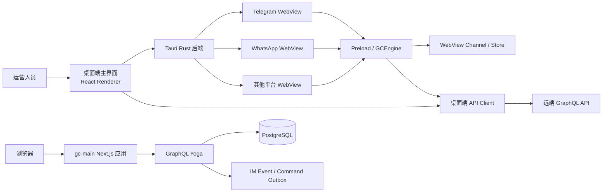
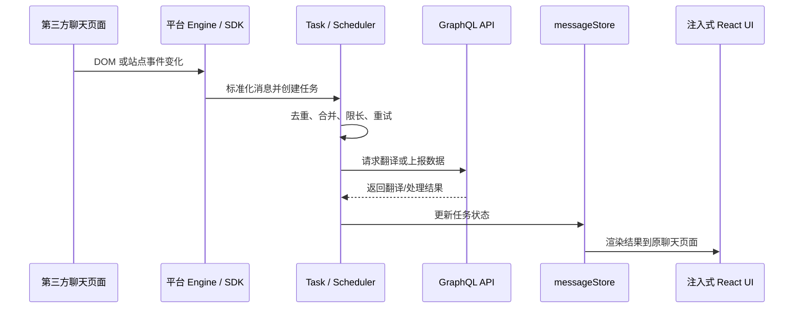

# Global Chats（GC）项目说明

> 基于 2026-09-18 当前工作区源码整理。本文描述的是 `gc` 目录下两个并列代码库的现状，不以旧版 `project_map.md` 为唯一依据。

## 1. 项目是什么

Global Chats 是一套面向跨境客服/社媒运营场景的多平台聊天工作台。它把多个第三方聊天网站装进一个 Tauri 桌面应用，通过注入脚本读取页面状态、捕获消息、提供翻译、代理、浏览器指纹和聚合会话等能力；同时由 Web 管理端和服务端负责用户、工作区、成员、配置以及 WhatsApp 聚合数据。

当前工作区由两个独立工程组成：

| 目录 | 定位 | 主要技术 |
| --- | --- | --- |
| `gc-app-mono` | Global Chats 桌面客户端及共享包 | Tauri 2、Rust、React 19、TypeScript、Vite、Zustand、Bun、Turborepo |
| `gc-main` | 官网、管理控制台、GraphQL 服务与数据库层 | Next.js 16、React 19、GraphQL Yoga、Prisma、PostgreSQL、pnpm |

两者在业务上相关，但不是同一个 workspace，也使用不同的包管理器和锁文件。开发、安装依赖和执行命令时必须分别进入对应目录。

## 2. 系统全景



需要特别注意：桌面端当前 GraphQL 文档和生成类型来自 `https://app.usegc.com/graphql`，并非由本工作区的 `gc-main` Schema 生成。因此上图中的“远端 GraphQL API”在默认开发配置下不必然等于本地 `gc-main`。

## 3. 目录结构

### 3.1 `gc-app-mono`：桌面端 Monorepo

```text
gc-app-mono/
├─ apps/
│  └─ global-chat-desktop/
│     ├─ src/                 # React 主界面
│     ├─ src-preload/         # 注入第三方 WebView 的入口
│     ├─ src-tauri/           # Rust/Tauri 后端、窗口和 WebView 管理
│     ├─ tests/e2e/           # Playwright 端到端测试
│     └─ scripts/             # 日志、状态导入导出等脚本
├─ packages/
│  ├─ gc-engine/             # 第三方平台适配、消息抓取和中间件
│  ├─ webview/               # WebView 生命周期、侧边栏、全局设置
│  ├─ channel/               # WebView 间事件通信
│  ├─ store/                 # 全局、用户、应用、消息状态
│  ├─ api/                   # GraphQL/HTTP 客户端及生成类型
│  ├─ app-init/              # 主窗口和第三方 WebView 初始化
│  ├─ model/                 # 共享枚举、配置和领域类型
│  ├─ ui/                    # 共享 UI 组件和样式
│  ├─ logger/                # 主窗口、WebView、Rust 日志桥接
│  ├─ i18n/                  # 中英文国际化资源
│  ├─ adapter/               # Tauri HTTP 等适配器
│  ├─ misc/、utils/          # 通用工具
│  └─ sync-utils/            # 同步辅助包
├─ tools/gc-verify/          # health、log、ui 验证 CLI
├─ turbo.json
└─ bun.lock
```

当前约有 621 个 TypeScript/TSX/Rust/GraphQL 源文件，已有 Vitest 单元测试与 Playwright E2E 测试。旧文档中提到的 `src-chat/` 当前并不存在，桌面应用构建脚本只构建 renderer 和 preload。

### 3.2 `gc-main`：Web 与服务端

```text
gc-main/
├─ packages/gc-app/
│  ├─ src/app/               # Next.js App Router 页面与 Route Handler
│  ├─ src/modules/           # auth、workspace、settings、IM、admin 等模块
│  ├─ src/server/            # GraphQL Schema、Prisma、JWT、分片键工具
│  └─ prisma/                # Schema、迁移和种子数据
├─ docker/                   # PostgreSQL 与示例应用容器
├─ aaa/prod/                 # SQLite 与附件形式的历史/运行数据快照
├─ pnpm-workspace.yaml
└─ pnpm-lock.yaml
```

这是一个 pnpm workspace，但当前业务实现集中在单一包 `packages/gc-app`。`aaa/prod` 下约有 13 MB、42 个数据/附件文件，与当前 Prisma PostgreSQL 主数据层不是同一存储格式，应当视为历史或运行数据，不要当作源码修改，也不要随意对外分发。

## 4. 桌面端架构

### 4.1 启动过程

1. `src/main.tsx` 初始化全局样式、React Query、Sentry（非开发环境）、日志收集器和错误边界。
2. `App.tsx` 调用 `@gc/app-init` 的 `initApp()`，初始化期间展示启动页。
3. `initApp()` 完成 API Client、WebView Channel、本地持久化 Store、全局设置和跨 WebView 事件监听。
4. React Router 进入登录页、主页、单聊页、设置页或右侧工具页。
5. Rust 端按用户配置创建第三方平台 WebView，并向页面注入编译后的 preload。
6. preload 调用 `gcEngine.mount()`，根据当前 WebView 对应的平台选择具体引擎。

主入口：

- `apps/global-chat-desktop/src/main.tsx`
- `apps/global-chat-desktop/src/App.tsx`
- `packages/app-init/src/init.ts`
- `apps/global-chat-desktop/src-preload/index.ts`
- `packages/gc-engine/src/GCEngine.ts`

### 4.2 多 WebView 模型

桌面端不是简单的单页浏览器壳。它至少包含：

- `main`：应用主界面，维护导航、账号列表、聚合聊天和全局状态。
- 第三方平台 WebView：直接打开 Telegram、WhatsApp、TikTok、LinkedIn 等 Web 页面。
- `secondary`：右侧浮动工具窗口，用于翻译、代理、指纹、客户画像等面板。

Rust 后端负责创建、显示、隐藏、重载、关闭 WebView，设置主题以及打开开发者工具。前端通过 Tauri Event API 封装的 `WebViewChannel` 在多个 WebView 间同步状态。

常见事件包括：

| 事件 | 方向 | 用途 |
| --- | --- | --- |
| `requestStoreState` / `sendStoreState` | 子 WebView ↔ 主窗口 | 子窗口启动时拉取全局状态 |
| `changeAppUserInfo` | 子 WebView → 主窗口 | 回报第三方平台登录用户 |
| `changeAppUnreadCount` | 子 WebView → 主窗口 | 更新未读数 |
| `changeAppCurrentChatUser` | 子 WebView → 主窗口 | 更新当前聊天对象 |
| `updateSettings` | 主窗口 → 子 WebView | 广播代理、指纹、翻译等配置 |
| `logout` | 子 WebView → 主窗口 | 清理平台登录态 |

### 4.3 平台适配引擎

`@gc/gc-engine` 通过平台枚举分派到具体引擎。源码中存在以下 8 个引擎：

- Telegram
- WhatsApp
- Instagram
- Messenger
- Facebook
- TikTok
- LinkedIn
- Microsoft Teams

但“有引擎实现”不等于“产品默认开放”。当前默认配置中明确标记 `support: true` 的社媒平台是 Telegram、TikTok、WhatsApp、Messenger、LinkedIn；Instagram、Facebook、Teams 和 WhatsApp Business API 默认关闭。所有已开放平台仍需要结合目标网站和注入逻辑在实际环境中验证。Fingerprint 是工具能力，不进入 `GCEngine` 的平台消息分派。

平台适配通常分为三层：

1. 平台 Engine：组织生命周期和页面观察。
2. 平台 SDK：识别登录用户、当前会话和平台事件。
3. 消息控制/适配器：解析 DOM 或站点内部模块、读取消息、注入增强 UI。

WhatsApp 目录已进一步拆成 `core`、`application`、`adapters`、`sdk`，并包含事件总线、上报器、去重和单元测试，是当前结构最完整的平台实现。

### 4.4 消息与翻译链路



`GCEngineMiddleware` 为平台能力提供统一接口，包含：

- 用户、联系人、会话、消息的标准化模型；
- 2 分钟窗口、每作用域最多 10,000 key 的默认去重；
- 网络、限流和后端错误的指数退避重试，默认最多 3 次；
- correlation ID、错误归一化和实时事件总线；
- 平台数据向后端上报、从服务端查询以及发送消息。

### 4.5 状态与持久化

主要 Store 的职责如下：

| Store | 内容 | 持久化/同步方式 |
| --- | --- | --- |
| `globalStore` | 用户配置列表、全局设置、当前登录用户 | 主窗口写入 Tauri Store |
| `userStore` | 当前用户对应的运行时配置 | 从 globalStore 派生并回写 |
| `appStore` | WebView、当前应用、未读数、聊天对象 | 内存状态 + Channel 广播，部分回写 |
| `messageStore` | 当前 WebView 的消息/翻译任务 | 主要为当前页面内存态 |

修改全局设置时，主窗口会向所有 WebView 广播；代理或浏览器指纹变化还会触发相关 WebView 重载。

### 4.6 聚合聊天

`src/modules/aggregated-chat` 是桌面端原生的聚合会话界面。当前 `SyncEngine`：

- 首次按 Connection/Cursor 接口加载 WhatsApp 账号、会话、参与者和消息；
- 默认每 5 秒轮询增量数据；
- 连续失败时最多重试 3 次，并使用指数退避；
- 数据进入独立的 `chatStore` 和 `syncStore`。

这条链路依赖桌面端生成 Schema 中的 `imtp.whatsapp.*` 接口，不能直接套用 `gc-main` 当前的 `im.whatsapp.*` 字段名。

### 4.7 Rust/Tauri 后端

Rust 层主要负责：

- 主窗口、第三方 WebView 和侧边栏窗口管理；
- WebView 布局、代理、主题和开发者工具；
- Tauri Store 本地持久化；
- HTTP、Shell、通知、对话框和系统打开能力；
- 日志写入、查询、导出；
- 应用自动更新。

当前桌面产品版本是 `1.3.0`，标识符为 `com.socialsmart.globalchats.app`，最低 macOS 版本配置为 14.0，同时配置了 macOS app/dmg 与 Windows NSIS 打包目标。

## 5. Web/服务端架构

### 5.1 页面分区

Next.js 应用包含三组界面：

- 营销站：`/`、`/products`、`/pricing`、`/blog`。
- 控制台：`/console/dashboard`、`/console/im/*`、`/console/settings/*`。
- 管理员：`/console/admin/configs`、`/console/admin/tables/*`。

此外还有登录、注册、工作区初始化和邀请码页面。

### 5.2 API

| 路径 | 作用 |
| --- | --- |
| `/graphql` | GraphQL Yoga，主要业务 API |
| `/console/api/auth/login` | 控制台登录 Route Handler |
| `/console/api/auth/register` | 控制台注册 Route Handler |
| `/console/api/workspace/create` | 创建工作区 |
| `/pusher/channels/auth` | 实时频道鉴权 |
| `/im/events/[...path]` | IM 事件入口；当前仅返回成功/接受，尚未处理实际负载 |
| `/api/health`、`/status` | 健康和版本状态 |

GraphQL 根能力包括：

- 用户登录、注册和当前用户；
- 工作区创建、邀请、成员与成员偏好设置；
- 管理员配置和数据库表浏览；
- WhatsApp 账号、会话、消息分页；
- 聚合会话/消息查询与发送命令入队。

### 5.3 认证与权限

- 密码使用 bcrypt，工作因子为 10。
- Access Token 使用 HS256 JWT，有效期 7 天。
- JWT issuer 为 `globalchats`，audience 为 `globalchats-console`。
- GraphQL 同时接受 `Authorization: Bearer` 和访问令牌 Cookie。
- `/console/*` 由 Next.js proxy 根据认证标记 Cookie 和访问令牌 Cookie做页面级重定向。
- 管理员表浏览和配置接口会额外检查 `isAdmin`。
- 工作区数据访问通过当前 session 的 `workspaceId` 做隔离。

### 5.4 数据模型

Prisma 使用 PostgreSQL，核心实体可分为四组：

1. 身份：`User`、`PasswordResetToken`、`EmailVerification`、`LoginAttempt`。
2. 多租户：`Workspace`、`UserWorkspace`、`WorkspaceMember`。
3. 配置与资源：`Config`、`Model`、`WorkspaceAttachment`、`WorkspaceTranslationEntry`。
4. IM：`ImWhatsappAccount`、`ImWhatsappConversation`、`ImWhatsappMessage`、`ImWhatsappParticipant`、`ImEventOutbox`、`ImCommandOutbox`。

WhatsApp 数据都带 `workspaceId`。账号、会话、消息分别以平台稳定标识建立唯一约束，便于幂等同步。

发送聚合消息时，服务端不会直接连接 WhatsApp，而是创建一条 `PENDING` 的 `ImCommandOutbox` 记录。代码库中尚未看到消费该命令并回写 ACK 的 worker，因此真正的投递执行应由外部服务承担，或仍待实现。

## 6. 两个工程如何衔接

理想链路是：

```text
第三方 WebView
  → GCEngine 捕获/标准化数据
  → gc-engine middleware 去重与重试
  → 桌面端 @gc/api 发起 GraphQL 请求
  → 服务端按 workspace 写入 PostgreSQL
  → 聚合聊天通过分页/轮询读取
  → 发送消息写入命令 Outbox
  → 外部投递器执行并回传状态
```

但当前源码存在 API 合同分叉：

| 桌面端期待 | `gc-main` 当前提供 |
| --- | --- |
| `imtp.whatsapp.accounts/conversations/messages/...` | `im.whatsapp.accounts/conversations/messages/...` |
| `im.login`、`translate`、`modelsByScene`、`proxies` 等 | 当前本地 Schema 中无对应字段 |
| 生成类型来源为 `app.usegc.com/graphql` | 本地 Schema 位于 `gc-main/.../schema.ts` |

因此，在把桌面端 `VITE_API_URL` 指向本地 `gc-main` 之前，应先完成 Schema 对齐、重新生成 GraphQL 类型，并跑合同测试。否则登录、翻译、代理、聚合聊天等功能会出现字段不存在或响应结构不匹配。

## 7. 本地开发

### 7.1 基础要求

- Node.js 24 或更高版本。
- 桌面端：Bun 1.3.5、Rust 工具链、Tauri 对应平台的系统依赖。
- Web 端：pnpm 10.x、Docker（推荐用于 PostgreSQL）。
- macOS 桌面端的项目约定要求在 macOS 14+ 做至少一次验证构建。

### 7.2 启动 Web 与数据库

```bash
cd gc-main
docker compose -f docker/docker-compose.yml up -d db
pnpm install
cp packages/gc-app/.env.example packages/gc-app/.env
pnpm db:generate
pnpm db:deploy
pnpm dev
```

默认服务端口是 `3300`，PostgreSQL 是 `5432`。

`gc-main` 的 `dev`、`start`、`clean` 脚本使用 `sh`、`lsof`、`kill`、`rm`，纯 Windows PowerShell 环境可能无法直接执行，应使用 WSL/Git Bash，或把脚本改为跨平台实现。

### 7.3 启动桌面端前端

```bash
cd gc-app-mono
bun install
bun --cwd apps/global-chat-desktop run dev
```

上述命令启动 Vite renderer（默认 `1420`）并监听构建 preload。若要启动完整 Tauri 窗口，使用：

```bash
cd gc-app-mono/apps/global-chat-desktop
bun run tauri dev
```

桌面端需要配置但不应公开提交其值的环境变量包括：

- `VITE_API_URL`
- `VITE_CMS_URL`
- `VITE_SENTRY_AUTH_TOKEN`
- `SENTRY_DSN`
- 开发环境自动登录相关变量

当前目录中存在实际 `.env` 文件；复制、打包或发送项目之前应检查其中的密钥，并确认它未进入版本控制或交付物。

### 7.4 常用验证命令

Web：

```bash
cd gc-main
pnpm lint
pnpm typecheck
pnpm test
pnpm build
```

桌面端：

```bash
cd gc-app-mono
bun run check-types
bun run lint
bun run test
bun run build
bun run verify:health
bun run verify:log
```

E2E：

```bash
cd gc-app-mono/apps/global-chat-desktop
bun run test:e2e
```

## 8. 开发导航

| 想修改的能力 | 优先查看 |
| --- | --- |
| 桌面路由与页面 | `gc-app-mono/apps/global-chat-desktop/src/routes/index.tsx` |
| Tauri 窗口/WebView 命令 | `gc-app-mono/apps/global-chat-desktop/src-tauri/src/gc_webview/` |
| 启动和跨窗口事件 | `gc-app-mono/packages/app-init/src/init.ts` |
| 平台分派 | `gc-app-mono/packages/gc-engine/src/GCEngine.ts` |
| 某个平台适配 | `gc-app-mono/packages/gc-engine/src/apps/<platform>/` |
| 上报、重试、去重 | `gc-app-mono/packages/gc-engine/src/middleware/` |
| 桌面 GraphQL 请求 | `gc-app-mono/packages/api/src/` |
| 聚合聊天同步 | `gc-app-mono/apps/global-chat-desktop/src/modules/aggregated-chat/` |
| Web 页面 | `gc-main/packages/gc-app/src/app/` |
| GraphQL Schema/Resolver | `gc-main/packages/gc-app/src/server/graphql/schema.ts` |
| 数据库模型与迁移 | `gc-main/packages/gc-app/prisma/` |
| 登录/JWT | `gc-main/packages/gc-app/src/server/lib/session.ts` |

## 9. 当前风险与待办建议

### 高优先级

1. **统一 API 合同**：确定线上 `imtp` Schema 与本地 `im` Schema 哪一套是目标合同；在同一来源上生成类型并建立 CI 合同测试。
2. **补齐消息闭环**：明确 `ImCommandOutbox` 和 `ImEventOutbox` 的消费者、重试、ACK、死信和幂等策略；当前仓库只看到生产 Outbox 记录的一侧。
3. **收紧桌面安全配置**：当前 Tauri 配置中 `csp` 为 `null`，窗口 `devtools` 为 `true`，HTTP 插件启用 `unsafe-headers`；发布前应按第三方站点注入需求制定最小权限策略。
4. **移除生产密钥风险**：检查桌面端实际 `.env`、Sentry token 和签名相关配置，确保密钥只通过本地或 CI 注入。
5. **强制生产 JWT_SECRET**：服务端代码带开发回退值 `dev-secret-change-me`，生产启动应在缺少 `JWT_SECRET` 时直接失败。

### 中优先级

1. 为 `gc-main` 增加 Resolver、权限、工作区隔离和 Outbox 的自动化测试；当前未发现 Web 项目的测试文件。
2. 将 Web 的 shell 命令改为跨平台脚本，降低 Windows 开发门槛。
3. 更新或替换旧 `gc-app-mono/project_map.md`，避免 `src-chat`、旧目录路径和旧接口名称继续误导维护者。
4. 给第三方平台 DOM 选择器建立冒烟测试；平台网页升级是注入式引擎最常见的失效来源。
5. 明确 `aaa/prod` 数据快照的来源、保留期限和脱敏策略，并从常规源码交付中隔离。

## 10. 新成员建议阅读顺序

1. 先读本文，建立两个工程和端到端链路的整体认识。
2. 阅读桌面端 `App.tsx`、`init.ts`、`GCEngine.ts`，理解主窗口与子 WebView。
3. 选择一个平台（建议 WhatsApp）沿 Engine → SDK → Middleware → API 追踪。
4. 阅读 `gc-main` 的 Prisma Schema 和 GraphQL 根类型，理解租户与 IM 数据模型。
5. 对比桌面 `.graphql` 文件和本地 `schema.ts`，确认正在开发的环境使用哪套合同。
6. 修改代码前先运行对应项目的类型检查和测试，修改平台注入逻辑后再做真实网站手工验证。

## 11. 分析边界

本文完成了静态源码、配置、路由、Schema、迁移、构建脚本和测试结构分析，没有启动数据库、登录第三方平台，也没有执行真实消息收发。因此以下内容仍需在目标环境验证：

- 第三方网站当前 DOM 与各平台引擎是否仍兼容；
- 代理、指纹隔离和多 WebView Cookie/存储隔离效果；
- 线上 GraphQL Schema 与仓库生成类型是否一致；
- Outbox 的外部消费者和实时推送服务是否已部署；
- macOS/Windows 安装包签名、更新与生产权限策略。
